Scanning with the TetrAMM or FX4
~~~~~~~~~~~~~~~~~~~~~~~~~~~~~~~~

With the above modes it is possible to use the TetrAMM or FX4 for data acquisition during various types of scans.

The following is screen shot of the TetrAMM screen in the free-running continuous aquisition state with 0.01 second averaging time.
Each scan described below used most of these settings, with the changes in the settings described for that scan type.

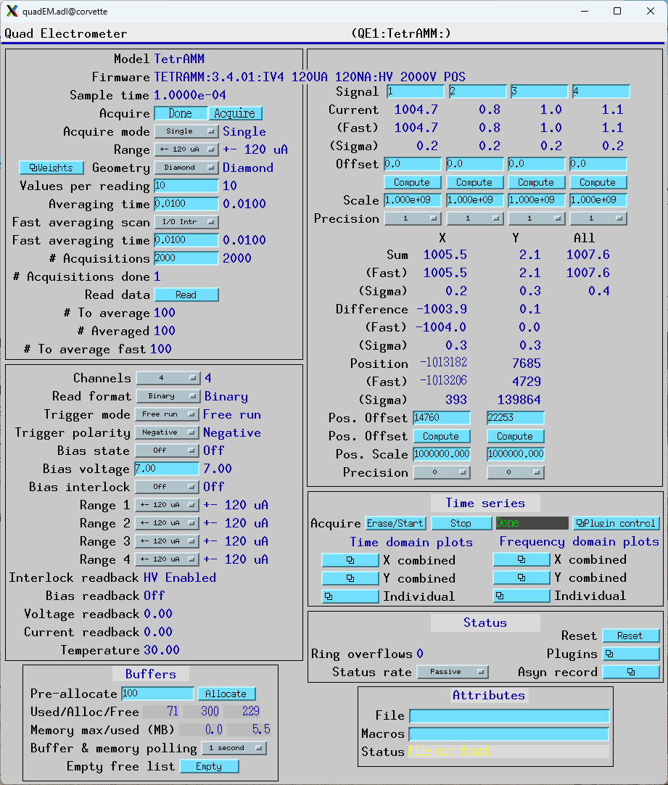

|

Step scan with quadEM in single acquire mode
.............................................
This scan type uses a step-scan for the positioner and runs the quadEM in single cycle mode.
This guarantees that the quadEM was only counting when the motor was at the target position
for each step.

For both of the following scans the quadEM was configured as follows:

- AcquireMode=Single
- ValuesPerRead=10
- AveragingTime=.01 s

The following is screen shot of the sscan record reading the first current from the TetrAMM.
There is no positioner for this test, which is designed to measure the step-scan overhead.
The first positioner readback is TIME, so the elapsed time for the scan can be measured.
In practice a motor or other positioner would be used.
The detector trigger is the quadEM Acquire PV.

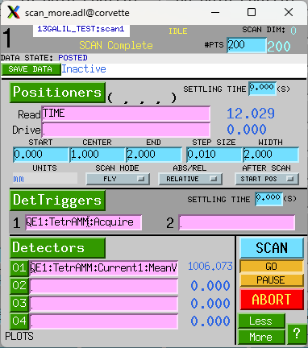

|

The scan is 200 points and took 12.0 seconds.  The actual collection time was 200*0.01 = 2 seconds.
The overhard was thus 10.0 seconds, or 50 ms per point.

The following is screen shot of the sscan record for the same scan using the FX4.

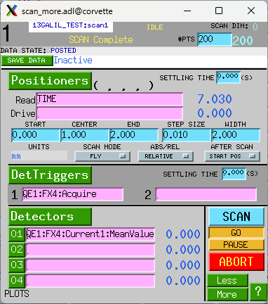

|

The scan is 200 points and took 7.0 seconds.  The actual collection time was 200*0.01 = 2 seconds.
The overhard was thus 5.0 seconds, or 25 ms per point.  This is half the overhead of the TetrAMM.

Fly scan with quadEM in free-run mode
.............................................
This scan type uses a fly-scan for the positioner and runs the quadEM in free-run continuous mode.
The scan is configured by setting the following:

- The total time for the scan is controlled by the number of points (.NPTS) and the detector settling time (.DDLY).
  In the example below .DDLY=.01 s, so that the 201 point scan will complete in 2 seconds.
- The motor speed must be set to so that it will reach the end position in the total time for the scan.
  In this case the motor travel is set to 2 mm, and hence the velocity is set to 1.0 so it will complete
  the move in 2.0 seconds.  This neglects the acceleration and deceleration times, which are 0.2 seconds.
- In Fly mode the sscan record starts the motor moving continuously to the final position.  While the motor
  is moving the sscan record records the motor readback position and the detector values continuously, with
  a delay of .DDLY.  This means that the detector values and motor positions recorded are synchronized within the
  accuracy and precision of their respective update rates.

The following is screen shot of the sscan record moving a single motor continuously and reading the 4 currents from the quadEM.

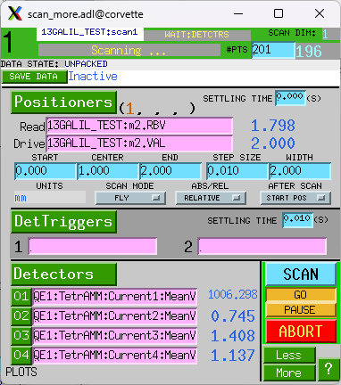

The scan is 201 points and took 2.038 seconds as shown on the readback for the second positioner = TIME.

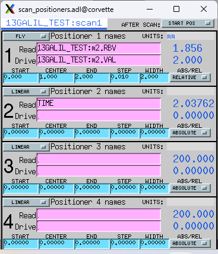

The quadEM was configured as follows:

- AcquireMode=Continuous
- TriggerMode=Free run
- ValuesPerRead=5
- AveragingTime=.01 s

This is a plot of Current1 after the scan.

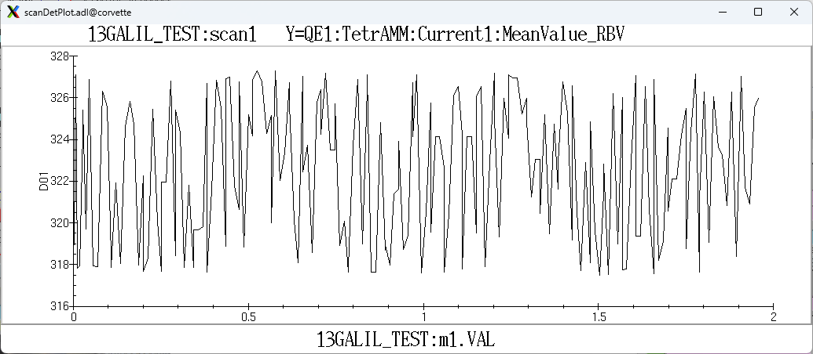

|

Fly scan in external triggered mode with the statistics plugin
...............................................................
This scan type uses triggers from the positioner to collect the quadEM data in the time series of the
NDPluginStats plugin. This guarantees that the positioner and detector data are perfectly synchronized.

For this test the triggers came from a Measurement Computing USB-CTR08 pulse generator, but they could
have been coming from position based triggers from a motor controller.

The pulse generator is configured to output 2000 pulses at 100 Hz, i.e. .01 second period.  However, this will work
even if the trigger period is changing, e.g. during the acceleration phase of a motor.
In this example the AveragingTime was set to 1.0 second, much longer than the 0.01 second pulse period.

The quadEM was configured as follows:

- AcquireMode=Multiple
- NumAcquire=2000
- TriggerMode=Ext. Trig.
- ValuesPerRead=10
- AveragingTime=1 second. Because this is longer than the pulse period it is irrelevant.

This is the configuration of the quadEM in this mode.

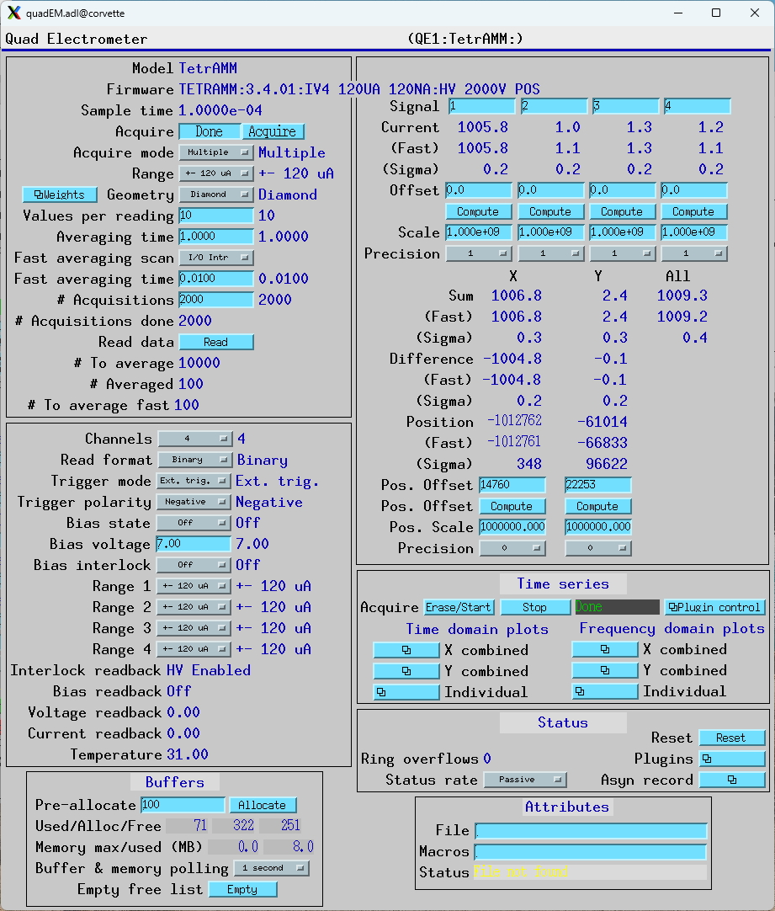

|

To navigate to the statistics time-series screen do the following:

- Open Plugins/QE common plugins. This is this screen:

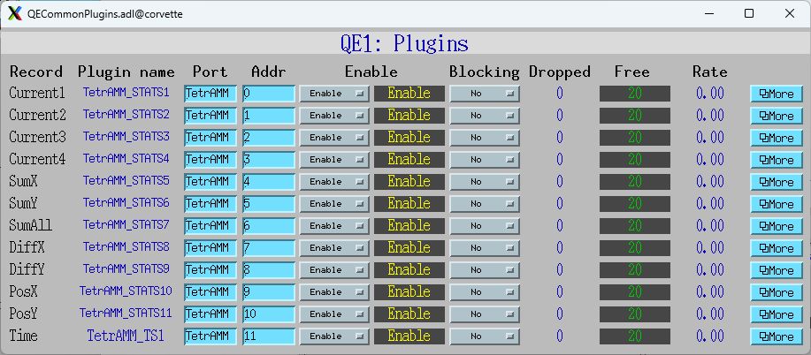

|

- Press More for Current 1, which opens NDStats.adl for Current 1. That is this screen:

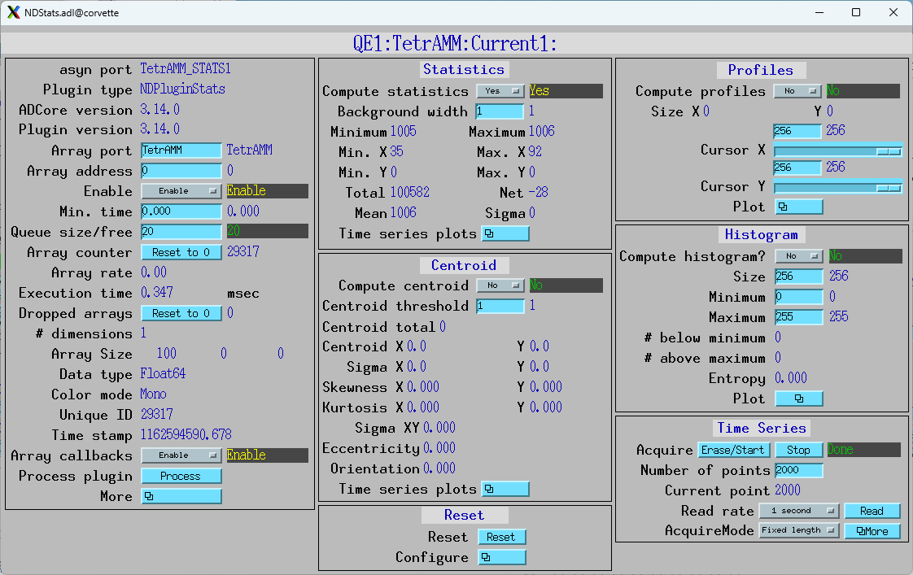

|

- Open Statistics/Time series plots/Mean. This is that screen before the scan:

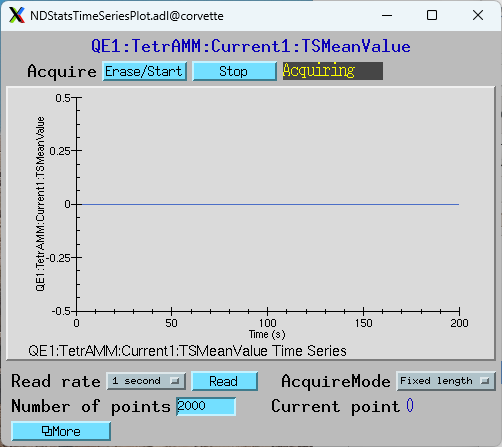

|

The number of points is set to 2000.

The following steps are used to perform a scan in this mode:

- Set the TSAcquire PV to 1 (press EraseStart in above screen)
- Set the quadEM Acquire PV to 1
- Start the trigger source.  In this test that is the pulse generator, but it would normally be the motor
  generating the trigger pulses.
- Wait for the motion to complete and then read the time series waveform records, e.g. TSMeanValue, etc.

This is a plot of Current1:TSMeanValue after the scan. The retrace at the last point is a bug in medm.
The vertical scale is expanded to show the small variations in the current.

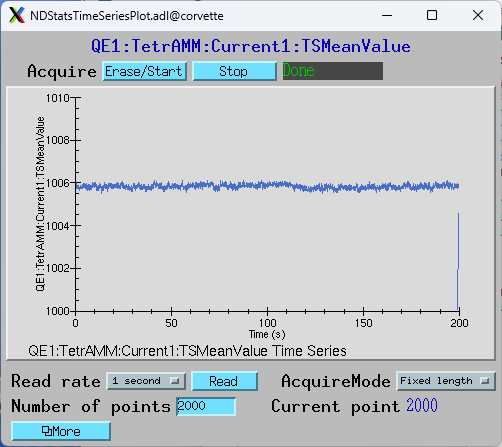

|

Note that this scan actually took 20 seconds but the horizontal scale in this plot is incorrect (200 seconds) 
because it has no way of knowing the actual time between triggers.  Each point in the plot is the mean
of all ADC values between the leading and trailing edge of that trigger pulse.
